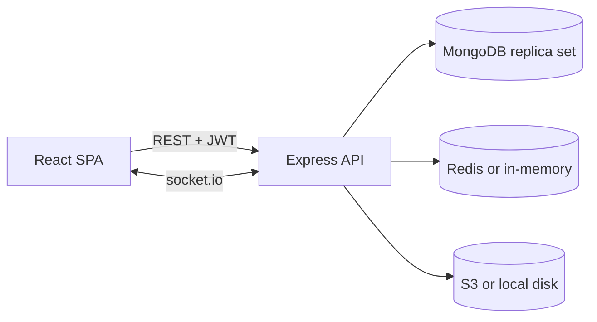

# Soccer Voting

A secure, real-time voting app for soccer awards. Admins create an event, add candidates, load the list of eligible voters and hand each one a single-use verification code. Voters (18+) register with their ID and code, cast exactly one vote, and everyone can follow live results.

- **Client:** React 18, TypeScript, MUI, Chart.js, socket.io-client (Vite)
- **Server:** Node.js, Express 5, TypeScript, socket.io, MongoDB (Mongoose), Redis
- **Repo:** npm workspaces: `client/` and `server/`

No Docker or locally installed databases are needed. In development the API uses an embedded MongoDB replica set, an in-memory Redis and local-disk image storage. Real Redis, S3 and MongoDB are switched on purely through environment variables. See [docs/aws-architecture.md](docs/aws-architecture.md) for production.

## Quick start

Requirements: Node.js 20.11+ (developed on Node 24) and about 1 GB of free disk space. The first run downloads a MongoDB binary (around 780 MB).

```powershell
npm install
copy .env.example .env      # optional: the defaults work for local development
npm run dev                 # dev database + API (port 4000) + client (port 5173)
```

Open http://localhost:5173.

### Create the first admin

With `npm run dev` running, set `ADMIN_EMAIL` and `ADMIN_PASSWORD` (12+ characters) in `.env`, then in a second terminal:

```powershell
npm run seed
```

The command is idempotent: it does nothing once an admin exists. Sign in at `/login`. You will be asked to enroll an authenticator app (TOTP) before any admin feature unlocks.

### First event, end to end

1. **Admin → Manage → Create an event.** Set the voting window and whether results are live or hidden until close.
2. **Candidates tab:** add at least two candidates. Photos must be JPEG, PNG or WebP and 2 MB or smaller.
3. **Voters & codes tab:** upload a CSV with the header `name,nationalId,dateOfBirth,email` (dates as `YYYY-MM-DD`, email optional), then click **Generate codes and download CSV**. Codes are stored only as hashes, so that download is the one chance to read them. You can issue a replacement code for a single voter who hasn't registered yet.
4. **Open voting.** Votes are accepted only inside the start/end window. The server closes the event automatically when it ends, or you can close it early.
5. **Voters** go to `/register` and enter their national ID, code, email and a password. They then vote from **My ballots**.
6. **Results** update live at `/events/:id`. Closed events appear under **History**. Admins can export final results as CSV or JSON from the event's **Results** tab.

## Scripts

| Command | What it does |
| --- | --- |
| `npm run dev` | Dev DB, API (watch mode) and client together |
| `npm run seed` | Create the first admin from `ADMIN_EMAIL` / `ADMIN_PASSWORD` |
| `npm test` | Server tests, then client tests |
| `npm run typecheck` | TypeScript checks for both workspaces |
| `npm run lint` | ESLint across the repo |
| `npm run build` | Production builds (`server/dist`, `client/dist`) |
| `npm run dev:db -w server` | Only the embedded MongoDB (data in `server/.data/`) |

## Configuration

All settings live in `.env` at the repo root (see [.env.example](.env.example)). Blank values fall back to development defaults.

| Variable | Default | Notes |
| --- | --- | --- |
| `MONGO_URI` | embedded dev DB | Must be a replica set: votes are written in transactions |
| `REDIS_URL` | *(empty → in-memory)* | Set for shared sessions, rate limits and multi-instance sockets |
| `S3_BUCKET` | *(empty → local disk)* | Also `S3_REGION`, plus optional `S3_ENDPOINT`, `S3_ACCESS_KEY`, `S3_SECRET_KEY` |
| `DATA_DIR` | `./.data` | Local image uploads (and dev DB data) |
| `JWT_SECRET`, `CODE_PEPPER`, `ENCRYPTION_KEY` | dev-only values | **Required in production.** The server refuses to start with the defaults |
| `ACCESS_TOKEN_TTL_SECONDS` | `900` | Access JWT lifetime |
| `REFRESH_TOKEN_TTL_SECONDS` | `604800` | Refresh token lifetime (rotated on every use) |
| `CLIENT_ORIGIN` | `http://localhost:5173` | CORS and socket.io allow-list |
| `TRUST_PROXY` | `0` | Number of proxies in front of the API, so rate limits see the real client IP |

Changing `CODE_PEPPER` invalidates every issued verification code and stored national-ID hash.

## Testing

```powershell
npm test
```

- **Server (Vitest + Supertest):** around 140 tests. They cover:
  - auth, MFA, refresh rotation and theft detection, RBAC and rate limits
  - CSV import and code generation
  - registration races and concurrent double votes
  - ballot secrecy, live results over a real socket.io server
  - scheduler, exports, history, and audit-chain tamper detection

  Tests use an in-memory MongoDB replica set, with a fresh database per test file.
- **Client (Vitest + React Testing Library):** component tests for every page and form, plus automated accessibility checks with axe-core, which include a control test proving the checker catches bad markup.

The client suite runs one file at a time (`fileParallelism: false` in `client/vite.config.ts`). On a machine with little free memory, parallel jsdom workers failed to start. If you have more headroom, removing that line speeds the suite up.

On a heavily loaded machine, Vitest can still occasionally report `Failed to start ... worker ... Timeout waiting for worker to respond` for one file, before any of its tests run. The start-up timeout isn't configurable yet ([vitest#11363](https://github.com/vitest-dev/vitest/issues/11363)). Re-run that file on its own, for example `npx vitest --run src/pages/RegisterPage.test.tsx` in `client/`, or free up memory and run the suite again.

## How it works



**Accounts and sessions**
- Passwords use argon2id.
- Access tokens are short-lived JWTs. Refresh tokens are opaque, stored hashed in Redis, and rotated on every use.
- Reusing an old refresh token revokes the whole session.
- Admins must use TOTP. The secret is encrypted with AES-256-GCM, and each code works only once.
- Ten failed logins lock an account for 15 minutes. Errors never reveal whether an email exists.

**Eligibility**
- Voters must match a row in the admin's uploaded list, by national ID (stored as an HMAC) and date of birth (checked for 18+).
- They must also present that voter's unused code.
- Claiming the code, creating the account and linking it happen in one transaction, so a code can only ever be used once, even under concurrent attempts.

**One person, one vote**
- A vote writes a `Participation` record (who voted, with a unique index on event and user) and a `Ballot` (what was chosen, with no link to the voter) in a single transaction.
- Neither record has timestamps. Their `_id`s are random rather than time-based, and ballots carry only a 5-minute bucket for the trend chart.
- The vote's audit entry records that a vote happened, never who cast it or what they chose.

**Live results**
- Per-candidate counters live in Redis and are updated after each committed vote.
- socket.io pushes snapshots to a room per event, throttled to one per second.
- A scheduler closes expired events and rebuilds the counters from MongoDB every 30 seconds, so any missed increment heals itself.
- Clients resync on reconnect and fall back to polling every 10 seconds while disconnected.

**Audit log**
- The log is append-only and hash-chained. Admins can verify it from **Audit**, and any edit or deletion shows up as a broken chain.
- Secret-looking fields are redacted before writing.

**Input handling**
- Every request body, query and route parameter is validated with zod.
- Uploads are type-checked by their magic bytes, not by the file name.
- CSV exports neutralise spreadsheet formulas.

## Known limitations

Be aware of these before relying on the app:

- **Untested here:** the real-Redis and real-S3 code paths, which cover the socket.io Redis adapter, the Redis rate-limit store and S3 uploads. No Redis or S3 was available while building this. Every test and the end-to-end run used the in-memory Redis and local-disk storage.
- **In-memory Redis is for one process only.** Restarting the API signs everyone out, and rate limits aren't shared between instances. Set `REDIS_URL` for anything beyond local use.
- **Ballot secrecy limits:** the design prevents linking a voter to a ballot through the API, exports or audit log. It does not protect against someone with raw database or oplog access, who could correlate insertion order within a transaction.
- **Live results leak timing:** an observer watching live counts can see which candidate each new vote went to as it arrives. If that matters for an event, choose **Hidden until the event closes**.
- **Close boundary:** a vote that passes its checks a moment before an event closes can still commit just after the close.
- **Refresh tokens in sessionStorage:** the refresh token is kept in `sessionStorage` (cleared when the tab closes). That is simpler than cookies, but readable by any script that runs through an XSS hole. Strict CSP on the SPA host reduces that risk. Moving to an `httpOnly` cookie is the stronger option.
- **Code delivery:** codes are delivered out of band. The app doesn't send email.
- **Accessibility:** automated axe checks pass and the UI uses semantic landmarks, labels, a skip link and text alternatives for every chart. Colour contrast can't be measured in the test environment. Full WCAG conformance still needs manual testing with assistive technologies and an expert review.

## Project layout

```text
client/            React SPA
  src/api/         fetch wrapper (token refresh), shared types
  src/realtime/    socket.io client and the live-results hook
  src/pages/       public, voter and admin pages
server/
  src/models/      Mongoose schemas
  src/services/    auth, registration, voting, results, scheduler, audit, ...
  src/routes/      Express routers
  src/realtime/    socket.io hub
  scripts/         dev database, admin seed
  test/            integration and unit tests
docs/              AWS architecture
```
