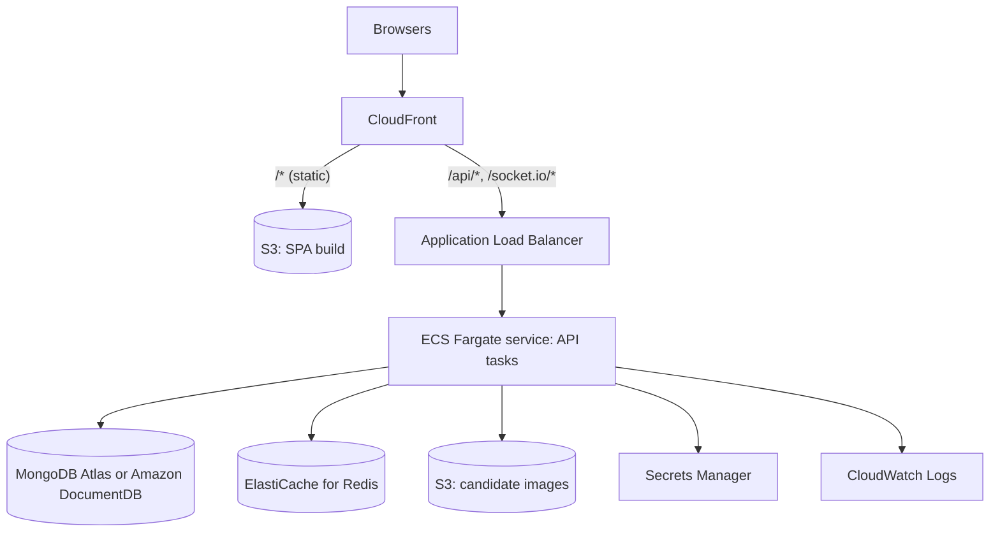

# AWS architecture

This is the intended production deployment. It is documentation only: no infrastructure is provisioned by this repo, and none of it has been deployed or tested against AWS.



## Components

| Concern | Service | Notes |
| --- | --- | --- |
| Static SPA | S3 + CloudFront | `npm run build -w client` output. Origin access control, so the bucket is private |
| API and WebSockets | ECS Fargate behind an ALB | At least 2 tasks across AZs. Health check `GET /health` (returns 503 if Mongo or Redis is down) |
| Database | MongoDB Atlas or DocumentDB | Must support multi-document transactions (replica set). Encryption at rest on |
| Redis | ElastiCache for Redis | Sessions (refresh tokens), live counters, rate limits, socket.io adapter. In-transit encryption and AUTH on |
| Images | S3 bucket (private) | Set `S3_BUCKET` and `S3_REGION`. Objects are written with SSE (AES256). The API streams them, so the bucket stays private |
| Secrets | Secrets Manager | `JWT_SECRET`, `CODE_PEPPER`, `ENCRYPTION_KEY`, DB and Redis credentials, injected as task env vars |
| Logs | CloudWatch Logs | The API never logs request bodies, tokens or ballot choices |

## Request routing

One CloudFront distribution keeps everything same-origin, which is what the client expects:

- `/*` goes to the SPA bucket, with `index.html` as the fallback for client-side routes (404 and 403 errors mapped to `/index.html` with status 200).
- `/api/*` and `/health` go to the ALB with caching disabled. Forward the `Authorization` header and the query string.
- `/socket.io/*` goes to the ALB with caching disabled. Forward all headers (or at least the WebSocket upgrade headers) and the query string. CloudFront supports WebSockets.

Set `CLIENT_ORIGIN` to the public CloudFront URL, for example `https://vote.example.com`.

## Configuration for production

```text
NODE_ENV=production
PORT=4000
CLIENT_ORIGIN=https://vote.example.com
TRUST_PROXY=2                 # CloudFront + ALB, so rate limits use the real client IP
MONGO_URI=<from Secrets Manager>
REDIS_URL=rediss://<elasticache endpoint>:6379
S3_BUCKET=<images bucket>
S3_REGION=<region>
# S3_ACCESS_KEY / S3_SECRET_KEY left empty: the SDK uses the ECS task role
JWT_SECRET=<secret>  CODE_PEPPER=<secret>  ENCRYPTION_KEY=<64 hex chars>
```

The server refuses to start in production while any of the three secrets still has its development default.

Set `TRUST_PROXY` to the actual number of proxies. Too high a value lets clients spoof `X-Forwarded-For` and dodge rate limits. Too low a value makes every request look like it came from the load balancer.

**Task role permissions:**
- `s3:PutObject`, `s3:GetObject` and `s3:DeleteObject` on `arn:aws:s3:::<images bucket>/candidates/*`
- read access to the specific secrets

## Scaling and realtime

- Several API tasks can run side by side when `REDIS_URL` is set. Sessions, counters and rate limits are shared in Redis, and the socket.io Redis adapter fans broadcasts out to clients connected to any task.
- The client prefers WebSockets. If the HTTP long-polling fallback is used, it needs ALB stickiness (application-based cookie), because a polling session must keep hitting the same task.
- Every task runs the scheduler. That's safe: closing an event is a conditional update that succeeds, and is audited, exactly once. Counter rebuilds are idempotent.
- Run `npm run seed -w server` once as a one-off ECS task (or locally against the production database) to create the first admin.

## Security notes

- **TLS:** TLS everywhere (viewer to CloudFront, CloudFront to ALB, ALB to tasks if required by policy, and TLS to Atlas, DocumentDB and ElastiCache). Votes are protected in transit by TLS and at rest by database and S3 encryption.
- **Ballot secrecy:** comes from the data model (ballots carry no voter reference, no timestamps and random ids), not from cryptography. Database and oplog access should be limited to as few operators as possible. See the README's known limitations.
- **Response headers:** the API sets helmet headers. Add a strict Content-Security-Policy and HSTS for the SPA through a CloudFront response-headers policy. This matters because the refresh token is stored in `sessionStorage`.
- **WAF:** consider AWS WAF on CloudFront, using rate-based rules in front of `/api/auth/*` and the vote endpoint, in addition to the app's own limits.

## Why there is no DynamoDB

The original technical spec listed DynamoDB for session management. The design spec chose JWT with refresh tokens. Refresh tokens are stored in Redis instead: Redis is already required for live counters, rate limits and the socket.io adapter, and it gives atomic `GETDEL` for single-use token rotation and native key expiry. A third data store would add cost and operational work without a functional gain.

## Reference container image (not built or tested here)

Docker wasn't available in the development environment, so this Dockerfile is a starting point only. It is not part of the repo and hasn't been built.

```dockerfile
# syntax=docker/dockerfile:1
FROM node:24-slim AS build
WORKDIR /app
COPY package.json package-lock.json ./
COPY server/package.json server/
COPY client/package.json client/
RUN npm ci
COPY tsconfig.base.json ./
COPY server server
RUN npm run build -w server && npm prune --omit=dev

FROM node:24-slim
ENV NODE_ENV=production
WORKDIR /app
COPY --from=build /app/node_modules node_modules
COPY --from=build /app/server/package.json server/
COPY --from=build /app/server/dist server/dist
USER node
WORKDIR /app/server
EXPOSE 4000
CMD ["node", "dist/index.js"]
```

Notes:
- `argon2` is a native module. Build and run on the same base image and CPU architecture.
- `mongodb-memory-server` and other dev tooling are removed by `npm prune --omit=dev`. The production image talks to a real MongoDB.
