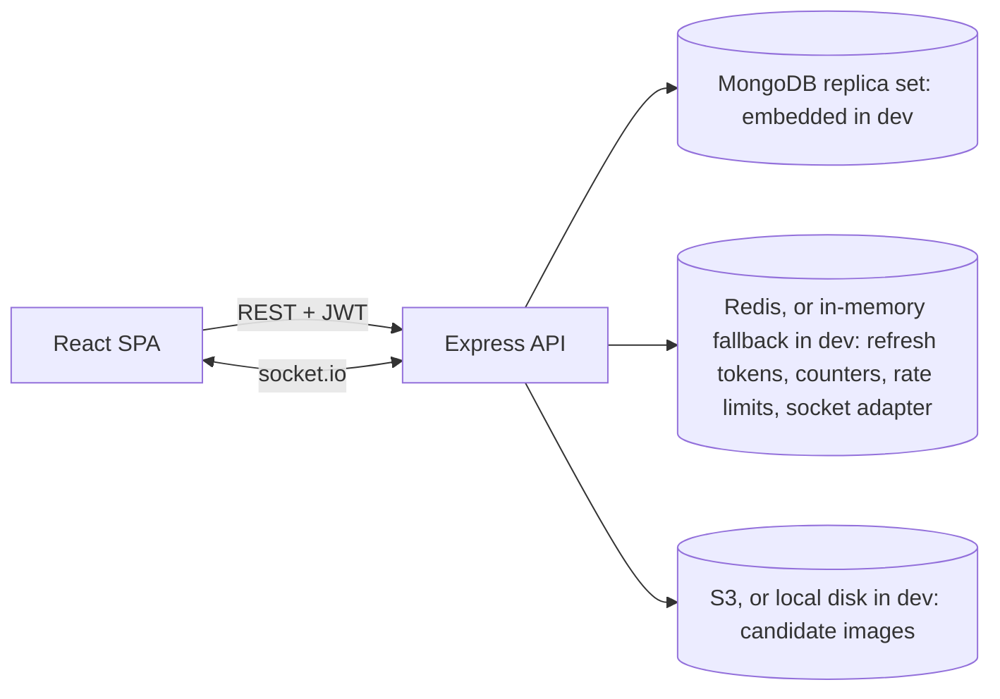

# Implementation Plan: Soccer Voting Application

## Problem Statement
Build a secure, real-time soccer voting web app. Eligible voters (18+, pre-loaded by an admin, each with a unique single-use code) register, log in, and cast exactly one vote for a candidate in an admin-created event. Everyone sees live results. Admins (seeded, with TOTP MFA) manage events, candidates, voter lists, codes, and exports.

## Requirements (from the specs and user answers)
- Stack: React 18 with TypeScript, MUI, socket.io-client, Chart.js. Node/Express, socket.io, MongoDB with Mongoose, Redis. No Docker (not available in this environment): local development uses an embedded MongoDB replica set (`mongodb-memory-server`, persisted to `.data/`), an in-memory Redis fallback (`ioredis-mock`, used when `REDIS_URL` is unset), and a local-disk image store (used when `S3_BUCKET` is unset). Production uses real MongoDB, Redis (ElastiCache), and AWS S3, selected purely by env vars.
- Sessions: JWT access tokens plus rotating refresh tokens stored in Redis. DynamoDB is dropped.
- Vote privacy: TLS in transit and encryption at rest. Ballots are stored separately from voter identity.
- Eligibility: the admin uploads the eligible voter list for an event. Registration must match it.
- Codes: one unique, single-use code per eligible voter.
- Admin: seeded first admin, RBAC, TOTP MFA (admins only). Voters use email, password, and their code (no MFA).
- Model: one event with many candidates.
- Repo: npm workspaces with `client/` and `server/`.
- Tests: TypeScript with Vitest, Supertest, and React Testing Library for unit, integration, and component tests.
- UI: modern, responsive, football-inspired dashboard.
- Deliverables also include AWS architecture documentation (ECS, CloudFront, S3) with no provisioning.
- Security: rate limiting, input validation and sanitization, audit logging of all actions.

## Assumptions
- Results are read-only and viewable without login, since the spec says "any user".
- "Previous voting history" means the voter is not already registered, and has not already voted in that event.
- "Valid identification" means the voter's national ID and date of birth match a row in the admin's uploaded list. The 18+ check uses the DOB on that row.
- Historical data means final results of closed events, plus a vote-over-time series for the current event.
- Each event has its own voter list and codes.

## Background and Research Findings (design decisions)
- **Duplicate-vote prevention:**
  - A `Participation` collection holds `{eventId, voterId}` with a unique compound index.
  - A `Ballot` collection holds `{eventId, candidateId}` with no voter reference and no precise timestamp, to avoid timing correlation.
  - Both are written in one Mongo transaction, so a second attempt fails atomically.
  - This needs a replica set, so the dev DB script (`npm run dev:db`) runs an embedded single-node replica set. Tests use the same mechanism.
- **Real-time counts:**
  - Mongo is the source of truth.
  - Redis holds per-candidate counters (`HINCRBY`), which feed the socket.io broadcasts.
  - The `@socket.io/redis-adapter` lets the server scale to several instances.
  - Counters can be rebuilt from Mongo on startup or on drift.
  - Broadcasts are throttled to about 1 per second.
- **Codes:**
  - Codes are 10 or more random characters from a CSPRNG.
  - They're stored as an HMAC-SHA256 hash with a server-side pepper, so they can be looked up without being stored in plaintext.
  - They're marked consumed atomically (`findOneAndUpdate` with `used:false`).
  - Plaintext codes are shown or exported once, when generated.
- **Passwords and MFA:** argon2 for passwords. `otplib` for admin TOTP, with the secret encrypted at rest. Refresh tokens rotate with reuse detection.
- **Security:** helmet, CORS allow-list, `express-rate-limit` with the Redis store (tighter on login, register, and vote), and zod validation on every endpoint. Uploaded images are validated for MIME type and size.
- **Audit:** an append-only `AuditLog` with a hash chain (each entry stores the previous entry's hash), so tampering is detectable. It logs actor, action, target, and IP, and never logs secrets or the chosen candidate.
- **Voting integrity edge cases:** votes are only accepted while the event is `open` and within its window. The server checks this, not just the UI. Closing happens on a scheduled check plus a check at vote time.

## Architecture

## Proposed Solution
Build it in vertical slices that follow the four phases in implementation.spec.md, with a foundation task first. Each slice is test-driven and demoable. The server uses layered modules (routes, services, models) and a storage interface for images. The client uses MUI with a football theme (pitch-green and white palette, scoreboard-style result cards).

## Task Breakdown

### Task 1: Monorepo and infrastructure scaffold
- Objective: a running skeleton for the client, the server, and the services.
- Guidance:
  - Set up npm workspaces with `client/` (Vite, React 18, TS, MUI) and `server/` (Express, TS).
  - Add shared ESLint, Prettier, and tsconfig.
  - No Docker. Add `server/scripts/dev-db.ts` (`npm run dev:db`): an embedded single-node MongoDB replica set persisted under `.data/`.
  - Add `createRedis()`: real ioredis when `REDIS_URL` is set, otherwise an in-memory `ioredis-mock` fallback (single process, non-persistent).
  - Local image storage is chosen when `S3_BUCKET` is unset (implemented in Task 4); the env vars for S3 are already defined.
  - Add typed env config validated with zod, a `/health` endpoint that checks the Mongo and Redis connections, and a `.env.example`.
  - Root `npm run dev` starts the dev DB, the API, and the client together.
- Tests: a health endpoint integration test; in-memory Redis and env tests; a client smoke render test.
- Demo: `npm run dev` shows the app shell and a healthy `/health` with no external installs.
- Status: done and verified (typecheck, lint, tests pass; `/health` returned ok against the embedded Mongo).

### Task 2: Core models, audit logging, and seeded admin
- Objective: the data foundation and the admin bootstrap.
- Guidance:
  - Mongoose models: `User` (role, TOTP secret), `Event`, `Candidate`, `EligibleVoter`, `VerificationCode`, `Participation`, `Ballot`, `AuditLog`.
  - Add the unique indexes.
  - Build the audit service with the hash chain and a verify function.
  - Add a seed script that creates the first admin from env vars.
  - Add shared error handling, request-ID middleware, and zod validation middleware.
- Tests: unit tests for the hash chain and tamper detection; model and index tests (mongodb-memory-server as a replica set).
- Demo: run the seed, then inspect the admin user and a verified audit chain.
- Status: done. National IDs are stored as HMAC hashes plus the last 4 characters (not plaintext).

### Task 3: Authentication core (Phase 1: login and sessions)
- Objective: login, JWT, and session management.
- Guidance:
  - Build login with argon2.
  - Issue a short-lived access token and a rotating refresh token in Redis, with reuse detection.
  - Add logout, an `authenticate` middleware, and an RBAC `requireRole` middleware.
  - Add rate limiting on the auth routes.
  - Add admin TOTP: enrollment (QR code), then verify at login.
  - Audit all of it.
- Tests: integration tests for login, refresh rotation, reuse detection, RBAC denial, and TOTP success and failure.
- Demo: the admin logs in with a password plus a TOTP code and calls a protected endpoint. Reusing an old refresh token is rejected.
- Status: done. Added account lockout (10 failures / 15 min) and TOTP replay protection.

### Task 4: Admin event, candidate, and image management (Phase 2 and 3 start)
- Objective: admins can create events and candidates.
- Guidance:
  - Event CRUD with a start/end window and a status (`draft`, `open`, `closed`).
  - Candidate CRUD with image upload through a storage interface with two implementations: local disk (default in dev, files served by the API) and S3 (used when `S3_BUCKET` is set; presigned URLs or a server proxy).
  - Validate image MIME type and size.
  - Enforce lifecycle rules, such as no candidate edits once the event is open.
  - Build the client login page (with the TOTP step), the admin layout, and the event and candidate screens in the football theme.
- Tests: service and integration tests for lifecycle rules and uploads; component tests for the forms.
- Demo: the admin logs in through the UI, creates an event with candidates and images, and sees them listed.
- Status: done. Image type is checked by magic bytes; images are streamed by the API (bucket stays private).

### Task 5: Eligible voter list and verification codes (Phase 3: code generator)
- Objective: the admin loads voters and generates codes.
- Guidance:
  - CSV upload of eligible voters (name, national ID, DOB, email), with row-level validation and an error report.
  - Duplicate detection within an event.
  - Generate one unique code per voter, stored as an HMAC hash.
  - Return or export the plaintext codes once as a CSV.
  - Allow regenerating a code for a voter who hasn't registered yet.
  - Build the matching admin UI.
- Tests: unit tests for code generation and hashing; CSV parsing edge cases (bad DOB, duplicates); integration tests.
- Demo: the admin uploads a CSV, generates codes, and downloads a one-time code sheet.
- Status: done. CSV exports neutralise spreadsheet formula injection.

### Task 6: Voter registration and login (Phase 1: registration and verification)
- Objective: the voter onboarding flow.
- Guidance:
  - Registration takes national ID, code, email, and password.
  - The server matches the eligible voter row, checks 18+ from the stored DOB, and checks the code is valid and unused.
  - It consumes the code atomically, creates the user, and links it to the eligible voter, with a generic error message to avoid enumeration.
  - Voter login reuses the Task 3 flow and checks eligibility (an active voter with an open or upcoming event).
  - Build the client registration and login pages.
- Tests: integration tests for underage, wrong ID, reused code, a concurrent double-registration race, and success; component tests for the forms.
- Demo: a voter registers with a code, logs in, and sees the voter dashboard. A second use of the same code fails.
- Status: done. Code claim, account creation and linking run in one transaction. A voter on several events reuses one account (password required).

### Task 7: Vote submission with duplicate prevention (Phase 2)
- Objective: one atomic vote per voter per event.
- Guidance:
  - `POST /events/:id/vote` checks that the event is open and within its window, and that the candidate belongs to the event.
  - In a transaction, insert `Participation` and `Ballot`.
  - After the commit, increment the Redis counters.
  - Add rate limiting and an audit entry (which logs that a vote happened, not who got it).
  - Build the voter UI: candidate cards with images, a confirm dialog, and a "you've voted" state.
- Tests: concurrency test (many parallel votes from one voter give exactly one ballot); closed-event and wrong-candidate rejections; a test that no ballot field links back to the voter.
- Demo: a voter votes once through the UI, and a second attempt (UI or API) is blocked.
- Status: done. Participation and Ballot use random `_id`s, because default ObjectIds embed a timestamp that would link them. The vote audit entry has no actor, IP or choice.

### Task 8: Real-time results (Phase 2 counting and Phase 4)
- Objective: live counts and percentages that update without a refresh.
- Guidance:
  - A socket.io server with a room per event. The Redis adapter is attached only when a real `REDIS_URL` is set; otherwise the default in-memory adapter is used.
  - A throttled broadcast of counts and percentages after each vote.
  - A snapshot endpoint for initial load, and counter rebuild from Mongo.
  - On the client: a results page with scoreboard-style candidate cards, a Chart.js bar or doughnut chart, a connection-status indicator, and reconnect and resync handling.
  - Results are readable without login.
- Tests: socket integration test (a vote leads to a broadcast); counter-rebuild unit test; component test for the results rendering.
- Demo: two browser windows, where voting in one updates the other's results live.
- Status: done. Verified with a real socket.io client in tests and in the end-to-end run.

### Task 9: Admin dashboard and event operations (Phase 3)
- Objective: operational control over events.
- Guidance:
  - Dashboard with turnout (registered, voted, remaining), event status, and quick actions.
  - Manual open and close.
  - Automatic open and close through a scheduler.
  - Results tallying options: live or hidden-until-close per event, with the rule enforced server-side.
  - An audit log viewer with chain verification.
- Tests: scheduler unit tests with fake timers; integration tests for the visibility rule.
- Demo: the admin watches turnout live, closes an event, and the status flips everywhere.
- Status: done. "Open" publishes an event; votes are accepted only inside its window, which gives automatic opening without extra state. The scheduler auto-closes events and reconciles counters every 30s. The dashboard polls every 5s.

### Task 10: Results export and historical data (Phase 3 export and Phase 4 history)
- Objective: exports and past events.
- Guidance:
  - Admin export of final results as CSV and JSON, plus a turnout summary.
  - Streamed output, and exports are audited.
  - A history page listing closed events with final results.
  - A votes-over-time series for the current event from bucketed Redis or Mongo aggregates, with no per-voter data.
- Tests: export format tests and aggregation tests; component test for the history list.
- Demo: the admin downloads a CSV, and anyone browses past event results.
- Status: done. Export only for closed events, audited before data is sent. The timeline has totals only, never per candidate.

### Task 11: Statistics dashboard and automated updates (Phase 4)
- Objective: the polished results experience.
- Guidance:
  - Chart.js statistics: turnout percentage, a vote trend line, and a candidate share comparison.
  - Socket-driven live updates for all charts, plus a polling fallback when the socket is disconnected.
  - Football-themed responsive layout across mobile, tablet, and desktop.
  - Accessibility pass: keyboard navigation, ARIA labels, color contrast, and a text alternative for charts.
- Tests: component tests for charts and fallback behavior; an accessibility lint (jest-axe or equivalent).
- Demo: a live stats dashboard that updates as votes arrive and works on a phone-sized viewport.
- Status: done. axe-core checks (with a control test) pass. Colour contrast can't be measured in jsdom; manual assistive-technology testing is still needed. Admin pages and Chart.js are lazy-loaded.

### Task 12: Hardening, docs, and final wiring
- Objective: production readiness and documentation, with nothing orphaned.
- Guidance:
  - Security pass: helmet, CORS, a rate-limit review, input sanitization audit, and a check that no secrets or ballot choices are logged.
  - Write `docs/aws-architecture.md` with mermaid diagrams: ECS Fargate, CloudFront in front of the SPA and the API, S3 for images, ElastiCache Redis, MongoDB Atlas or DocumentDB, Secrets Manager, and notes on TLS, encryption at rest, and the DynamoDB-to-Redis decision.
  - Write the README with setup, seeding, env vars, and a test guide.
  - Include a reference Dockerfile for ECS inside `docs/aws-architecture.md` as documentation only. It isn't built or run here, and no Docker files are added to the repo.
  - Verify the real-Redis path (socket.io Redis adapter, Redis rate-limit store) only if a `REDIS_URL` is available; otherwise document it as untested.
  - Add a root `npm test` that runs everything.
  - Run an end-to-end manual walkthrough covering admin setup, voter registration, voting, live results, and export.
- Tests: full suite green; a lint and typecheck gate.
- Demo: from a clean clone, the README steps give a working app, and the full flow runs end to end.
- Status: done. A 35-step end-to-end run against real processes (embedded Mongo, API, socket.io, Vite proxy) passed. Real Redis and S3 paths remain untested (not available here); see README "Known limitations".
